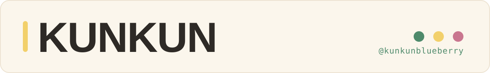
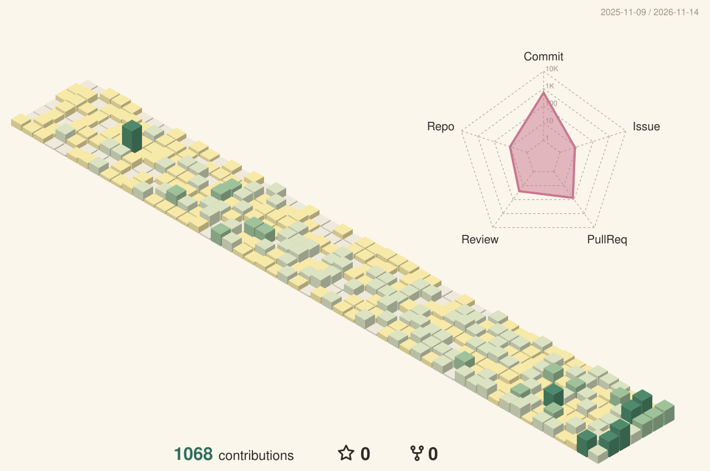
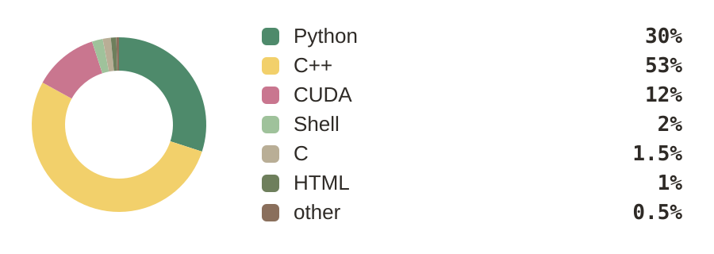

<!--
  kunkunblueberry/kunkunblueberry — profile README
  Entry point only — details live in the repos and PRs.
-->

  

  <b>AI Systems / LLM Inference · vLLM / vLLM-Omni · C++ / CUDA / Python</b> 
  From CUDA kernels and a hand-built runtime up to vLLM upstream — source first, minimal scope, verified changes.

  

### Selected Work

- **LLM Inference Systems** — built and optimized inference runtimes across scheduling, KV cache, memory management, and model execution · `C++ / CUDA / Python`
- **Prefix Cache & Cross-Stage Inference** — designed cache lifecycle and state-management abstractions for cross-stage intermediate-state reuse in multimodal inference · `vLLM / vLLM-Omni`
- **Multimodal Serving & Scheduling** — worked on cross-stage execution, request batching, and scheduling for autoregressive and diffusion pipelines · `Distributed Inference / PyTorch`
- **Diffusion Serving Sessions** — designing session scheduling, replica placement, and capacity reservation for AR-diffusion pipelines (ongoing RFC work in vllm-omni)

### Open Source

- **[vllm-project/vllm-omni](https://github.com/vllm-project/vllm-omni)** — cross-stage multimodal inference: prefix-cache upstream lifecycle (`#7920`), duplex session lifecycle & cold-start budgeting (`#9107`), TTS / benchmark / tool-delegation fixes (`#9029 #9101 #9149`); RFC in progress on diffusion session scheduling (`#9725 #9726`)
- **[InferMatrixLab/vllm-rlt](https://github.com/InferMatrixLab/vllm-rlt)** — looped-transformer inference engine: integrated Nanbeige4.2 with PD serving (`#77`), scoped batch-selection protection (`#68`); RFC open on sparse decode attention for async self-speculation (`#157`)
- **[kvcache-ai/Mooncake](https://github.com/kvcache-ai/Mooncake)** — KVCache-centric serving platform: restore lifecycle state machine and worker admission for the Store (`#4736`)
- **[verl-project/verl-omni](https://github.com/verl-project/verl-omni)** — multimodal RL training: honor-or-reject rollout expert parallelism (`#823`); DiffusionOPSD on-policy self-distillation in review (`#779`)
- **[ThinkFlowLab/OpenDirector](https://github.com/ThinkFlowLab/OpenDirector)** — 12 merged PRs hardening an open-source video-generation pipeline: state-consistency bugfixes, browser test matrix for MP4 export, UTF-8 contract fixes, validation docs

### Contribution Graph

<picture>
  <source media="(prefers-color-scheme: dark)" srcset="https://raw.githubusercontent.com/kunkunblueberry/kunkunblueberry/output/github-contribution-grid-snake-dark.svg">
  <source media="(prefers-color-scheme: light)" srcset="https://raw.githubusercontent.com/kunkunblueberry/kunkunblueberry/output/github-contribution-grid-snake.svg">
  
</picture>

<!-- 3D 图里 action 自带一个按仓库主语言统计的饼图，会把这个 profile 讲反（见 .github/strip-lang-pie.py），
     workflow 已把它剥掉。
     注意：raw.githubusercontent 按「路径」缓存、忽略 query string，camo 也按 URL 缓存，
     所以改了图内容必须换「文件名」（不是加 ?v=），否则页面会继续显示旧图。 -->

### Elsewhere

| | |
| :-- | :-- |
| **GitHub** | **[@kunkunblueberry](https://github.com/kunkunblueberry)** |
| **Email** | **[kunkunblueberry@gmail.com](mailto:kunkunblueberry@gmail.com)** |
